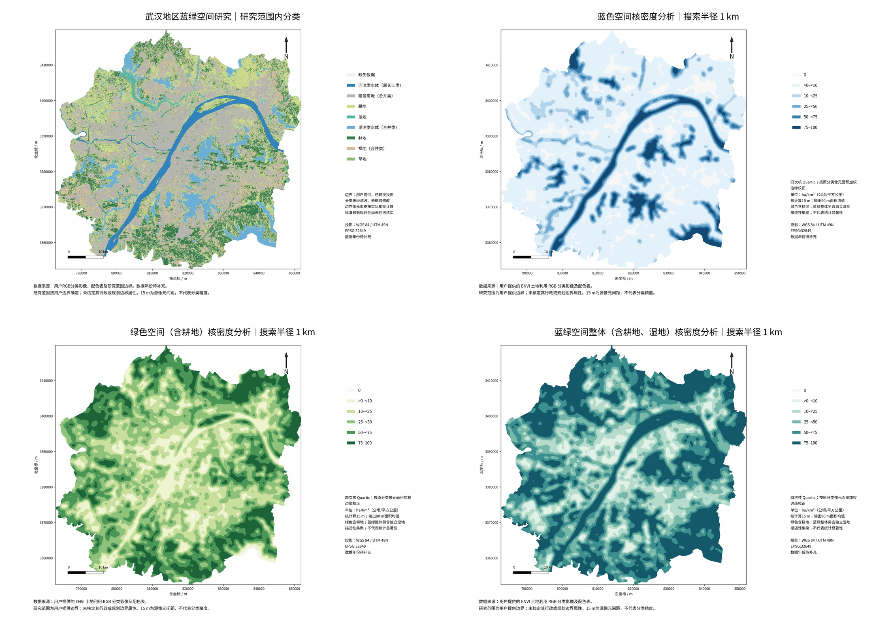

# 武汉地区蓝绿空间研究：当前为用户研究范围版

**当前成果已按新上传的研究边界重新计算，不再以整幅TIFF矩形作为研究范围。**

- **[下载研究范围分析与真实GDB包](study_area/wuhan_study_analysis.zip)**：分类、蓝绿提取、三尺度精确网格面积、Moran/LISA/Gi*、Shapefile/GPKG/GDB、43组地图。
- **[下载研究范围核密度包](study_area/wuhan_study_kde.zip)**：三类面积加权四次核，主半径1km及500m/2km比较，原始/边缘校正GeoTIFF、19组地图、ArcMap着色显示、可复现脚本。
- [当前研究范围结果与方法](study_area/README.md) · [主要地图](study_area/main_maps)

研究范围面积3255.587236 km²（在原影像EPSG:32649投影平面计算）；蓝色13.5961%，广义绿色（含耕地）41.0528%，独立湿地0.8601%，蓝绿整体55.5090%。面积守恒、边缘像元与网格交集、统计推断、FDR、数据回读和地图检查均已完成。范围内有效分类覆盖为100%。

原边界EPSG:4547，含2个面，其中1个自相交修复面积变化约0.000004m²；约6m²小面保留。原文件不覆盖。CGCS2000到WGS84使用PROJ默认近似变换，转换精度未知、无独立控制点，面积数值核对精度不等于空间配准精度。

GDB为实际创建并回读验证的真实数据库。云端无ArcGIS，未通过ArcMap打开验证，也未生成真实MXD；随包提供本机ArcMap10.5/Python2.7生成MXD的脚本。分类标准最新现行性尚未在线核实，数据年份待补充，无独立分类精度样本。边界的行政/规划属性未独立核定。

## 复现

两个ZIP分别解压为并排的`wuhan_study`和`wuhan_study_kde`。分析包运行`bash scripts/run_all.sh`可先重算分析、更新核密度输入，再重算KDE；各包也有独立入口。配置、输入、固定依赖、中文字体及许可、QA和SHA256清单随包保留。

## 历史整幅影像版本（仅作对照）

以下目录在新边界上传之前，以影像覆盖区为分析范围；不作为当前研究范围结果。两版差异来自范围改变，不代表时间变化或生态退化。

- [原整幅影像分析](wuhan_research)
- [原整幅影像核密度](kde)
- [原整幅影像ArcGIS专用包](arcgis105)
