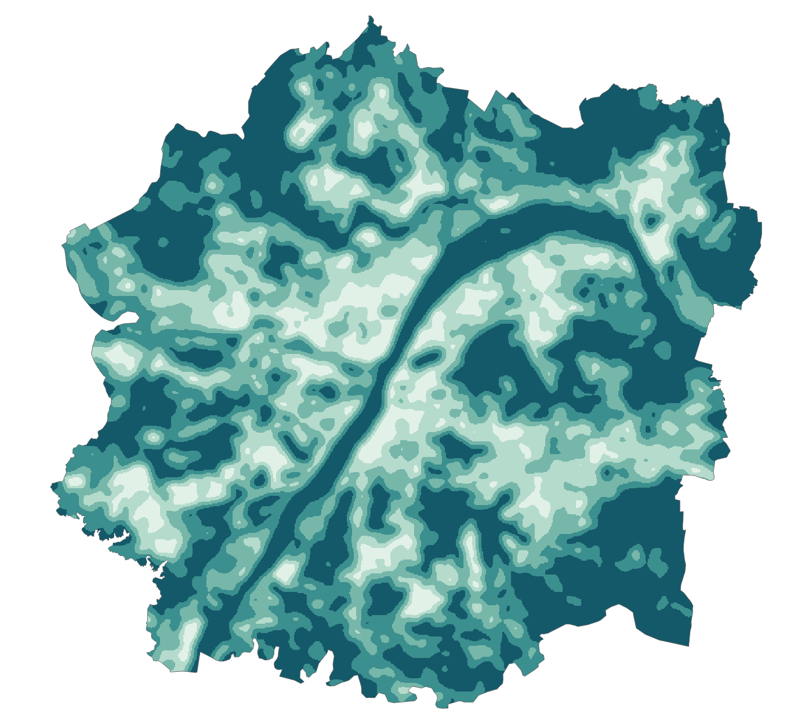

# 客户GIS整合交付｜用户研究范围版

## 两个对应软件的交付文件

| 软件 | 下载 | 打开方式与实际状态 |
|---|---|---|
| QGIS | **[Wuhan_Study_QGIS.qgz（59.9 MiB）](Wuhan_Study_QGIS.qgz)** | 自包含原生工程，数据已内嵌。QGIS 3.40 LTR或更新版本直接双击打开；已用3.40.6迁移文件后重新打开验证。 |
| ArcMap 10.5 | **[Wuhan_Study_ArcMap105.zip（76.2 MiB）](Wuhan_Study_ArcMap105.zip)** | 完整数据/配色整合包。解压后可直接导入GDB和已配色图层；真实MXD/MPK需交付方在本机ArcMap初始化一次。云端没有ArcGIS，包内不含预制MXD/LYR/MPK。 |

[QGIS单文件使用说明](QGIS_README.md) · [14页原生QGIS图集PDF](QGIS_Map_Atlas.pdf) · [原生布局预览](QGIS_layout_preview.pdf)

## QGIS：可直接交给客户打开

`.qgz`内部包含GeoPackage、47个科学数值栅格和工程样式，无需另找数据文件夹，无联网底图依赖。86个图层/表，14个地图主题，14个A3打印布局，默认显示边缘校正的蓝绿整体1km核密度。研究范围、分类、分布、核密度、LISA、Gi*、三尺度敏感性、原始值和完整属性均保留。类别ID为整数，标准代码为文本，保留前导零。

## ArcMap：把客户需要的内容集中在一个目录

包内是**真实文件地理数据库、全部科学数值GeoTIFF、43个已配色地图显示栅格、完整CSV/字段字典、方法和质量记录**。不需要客户从零配色。显示RGB只用于看图，计算和数值查询应使用原始数值栅格或GDB字段。

如需客户直接双击地图工程，请交付方先完成一次本机初始化：

1. 将ZIP完整解压，双击 `OPEN_ARCMAP.cmd`，使用已安装且可用的ArcMap 10.5自带Python。
2. 入口寻找真实空白MXD模板；没有时会提示选择您在ArcMap中新建并保存的空白MXD，无需编辑代码。
3. 本机实际生成 `Wuhan_Study.mxd`、相对路径的真实 `.lyr`，检查断链；还会尝试由ArcGIS生成单文件 `Wuhan_Study.mpk`。
4. MPK生成成功时可直接发该单文件给客户。否则发整个目录，客户双击真实MXD即可。不要仅发MXD而丢掉Data/Views。

**这一步未在云端执行或验证。** 当前ZIP本身可直接导入使用，但它不是已生成的MXD/MPK。初始化的成功/失败由本机日志记录，不会用改后缀的假文件代替。

## 检查证据

- QGIS：单文件移至另一目录重新打开，全部86层有效；项目数据引用全部为内嵌附件，无外部数据路径。实际渲染地图；14个打印布局均导出PDF；比例尺已核对为2×5km。
- ArcMap数据：全部原始科学GeoTIFF与研究成果逐字节一致，所有栅格完整读取；GDB图层/字段/NULL/坐标重读通过；标准代码前导零保持；100个随机LISA显示像元与原始类别字段颜色独立核对一致。仅将类别对应表的SRC_ID/CLASS_ID改为整数以方便连接，标准代码仍是文本。
- ArcMap桌面打开、MXD/LYR/MPK生成：未运行，需真实ArcGIS环境。云端提供的是准备完成的数据和本机生成入口。

详细记录在qa目录及ArcMap包的Documents，SHA256随两个交付文件提供。源构建脚本在scripts；QGIS构建脚本使用系统PyQGIS 3.40，不是arcpy。

## 数据口径与限制

两个交付都采用最新用户研究边界：面积3255.59km²（EPSG:32649投影平面），蓝绿整体55.5090%。广义绿色含耕地，蓝绿整体含独立湿地。KDE单位ha/km²，网格占比单位%，KDE深色并不等于Gi*显著热点或生态质量。

数据年份待补充；分类精度无独立样本；标准最新现行性未在线核实；CGCS2000到WGS84使用默认近似转换，无控制点精度验证；边界行政/规划属性未独立核定。完整科学分析与复现见上级study_area目录。
