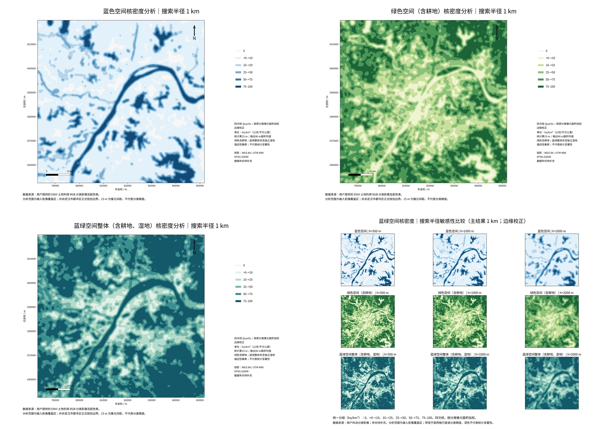

# 蓝色、绿色及蓝绿整体核密度分析（新增成果）

**本目录回应新的核密度需求。原 `wuhan_research/` 内的500m/1km/2km网格密度仍是面积占比，不改称核密度。** 新成果以原分类像元面积为权重计算核密度，描述土地覆被面积分布的集聚特征。

## 下载和主图

[下载核密度完整成果包](wuhan_kde_results.zip) · [预览](main_preview.jpg)

主结果：四次核，搜索半径 **1000m**，按有效观测范围进行边缘校正，单位 **ha/km²（公顷/平方公里）**。

- [蓝色空间核密度图](main_maps/KDE_blue_h1000_edge_corrected.png)
- [绿色空间核密度图（含耕地）](main_maps/KDE_green_h1000_edge_corrected.png)
- [蓝绿整体核密度图（含耕地、湿地）](main_maps/KDE_blue_green_h1000_edge_corrected.png)

包内19组A3横版300DPI PNG/PDF、三种带宽的原始/边缘校正GeoTIFF、ArcMap着色显示GeoTIFF、统计表、配置、脚本、字体和校验记录。



## 口径与单位

蓝色=河流类水体+湖泊类水体；广义绿色=耕地+林地+草地；独立湿地另计；蓝绿整体=蓝色+绿色+独立湿地，排除建设用地和裸地。没有对输入分类重新识别、去斑或平滑；核平滑仅用于本次空间密度分析。

每个15×15m目标像元的质量为0.0225公顷，不使用斑块质心数量。以像元中心承载其面积质量，未将全部像元矢量化。四次核：

`K_h(d)=3/(π h²) × (1-d²/h²)²`，当`d<h`；否则为0。h和d以km计时核单位km⁻²。原始核密度 `λ(s)=Σ w_i K_h(s-c_i)`，w以ha计，因此λ为ha/km²。

以15m间距对连续核进行离散求积并归一化，使离散核积分为1。计算采用带足够halo的行分块FFT卷积，不作整幅像元矢量化。有限像元中心近似和求积归一化均记录，未宣称是连续面精确积分。与ArcGIS常见四次核思路一致，但不声称数值等于ArcGIS所有默认参数。

主图边缘校正为 `λ_edge(s)=λ_raw(s)/E(s)`，E为核在有效观测范围内的权重比例。它减少边界/缺失截断造成的低估，不推断影像以外的类别。原始未校正KDE和核曝光比例同时交付，以便对照传统截断KDE。边缘校正后不要求全幅积分等于原始面积；原始截断KDE在影像内的积分按曝光比例检验，不能强行当作全幅面积守恒。

原分类仍为15m；核计算也使用15m源像元。为兼顾文件体积和绘图，输出采用核密度面的 **6×6面积均值，即90m栅格**。4608列和4494行均可被6整除，输出768×749，严格保持原投影、范围及整像元对齐。输出值是核密度面的格均值，不是把90m像元重新分类。检验了15m计算与90m输出积分的一致性。

主半径1km是预先采用的常规展示参数；另计算500m和2km，不以显著区域多少选择带宽。带宽为**核搜索半径**，不是原来的网格尺度，不代表分类精度。所有半径采用固定密度分级：0、>0–<10、10–<25、25–<50、50–<75、75–100 ha/km²。面积权重下最大值100 ha/km²相当于邻域内全为目标类别；不是点数量/km²或斑块数量/km²。

## 结果解读

蓝色高核密度主要呈河流类水体走向上的带状集聚，并在部分较大湖泊类斑块形成集中区；绿色及蓝绿整体在影像外围较高，中部建设类较集中的区域总体较低。500m保留更多局部细节，2km形成更宽、更连续的集聚带；1km为本次主展示尺度。具体数值分布见`tables/kde_surface_statistics.csv`，这些是密度面统计，不替代原始类别面积表。

KDE属于描述性分布集聚分析，没有统计显著性p或q；不把深色区称为Gi*显著热点，也不解释为生态服务、生态重要性或发展潜力。原有Moran/LISA/Gi*仍基于原网格面积占比，未把它们的p值套在KDE上。

## 质量核查

核离散积分、脉冲质量守恒、FFT与直接卷积、小块halo与整幅卷积、恒定场边缘校正均通过测试。实际影像检查了蓝+绿+湿地的核密度与蓝绿并集线性相加、原始截断密度积分、90m聚合积分、范围/CRS/数值范围及输出完整回读。零值按紧支撑核及最近目标像元距离恢复，避免把FFT微小正噪声画成真实密度；没有用任意阈值删除微小真实值。

地图PNG和PDF已解析/渲染核查；云端没有ArcGIS，未声明已通过ArcMap打开验证。核密度主图与敏感性图将做逐图联系表检查，记录在qa。

## ArcMap 10.5

`data/kde_*_edge_corrected.tif` 是用于分析的浮点核密度；`data/kde_*_raw.tif`为传统未校正值。`display_KDE_*_h1000_RGB.tif`仅为与正式主图分级一致的着色显示栅格，不可把RGB波段当作密度统计。

解压包后可直接把GeoTIFF添加到ArcMap10.5。另附`add_kde_arcmap105.py`，在本机ArcMap Python窗口导入并调用 `create_kde_mxd(解压目录, template='CURRENT')` 可将核密度层加入当前工程并保存真实MXD；云端未运行或伪造MXD。

## 复现

解压专用成果包并保持目录，Python3.12运行：

```bash
bash scripts/run_kde.sh
```

配置在`config/kde.json`，包括RGB恢复分类输入路径、蓝绿归属、搜索半径、核函数、输出单位、分块行数、输出90m聚合与制图分级。分类输入随专用包保留在`input/`。GitHub仓库内直接运行时，默认读同仓库原恢复分类，并按配置输出到云工作区；可改`output_root`。固定依赖与实际版本随包保留。所有分析均为开源工具，不依赖ArcGIS或付费API。

## 数据限制

分析范围为输入影像覆盖区，不是武汉市都市区正式规划边界；数据年份待补充；15m为像元间距，无独立精度样本。分类标准按自然资发〔2023〕234号对应整理，最新现行性尚未在线核实；水体/建设/裸地的类别语义限制沿用原报告。核密度不会消除原始分类错误或数据年份的不确定性。
